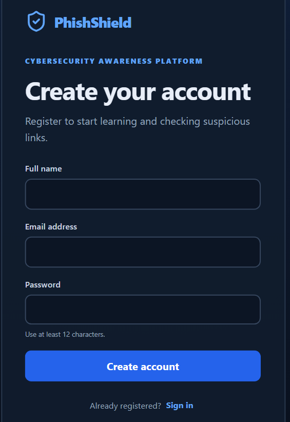
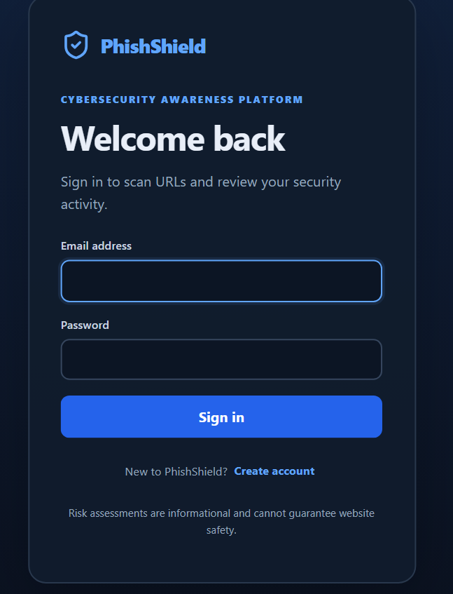
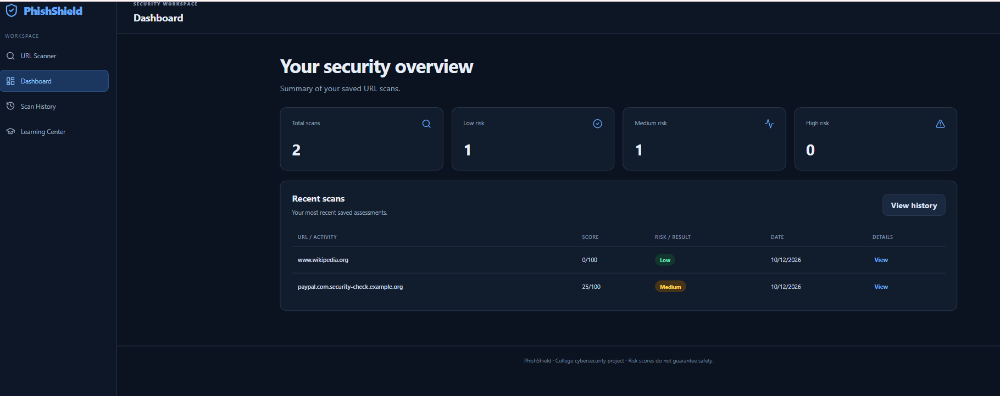

# PhishShield – Phishing Awareness and Detection Platform

PhishShield is a full-stack cybersecurity web application designed to help users identify potentially malicious URLs, understand phishing indicators, and develop safer browsing habits. It analyzes submitted URLs, assesses their risk, and provides explanations and recommendations to encourage safer online behavior.

## Features

- **User Authentication**: Registration and login for accessing protected features.
- **URL Scanner**: Analyze submitted URLs for suspicious characteristics.
- **Risk Classification**: Categorize scan results as LOW, MEDIUM, or HIGH risk.
- **Explainable Analysis**: Display suspicious indicators that contribute to a risk assessment.
- **Threat Intelligence**: Check URL reputation using a configured external security service.
- **Dashboard**: View scan summaries and security-related information.
- **Scan History**: Review previously analyzed URLs and their results.
- **Learning Center**: Explore phishing-awareness resources and safe browsing practices.
- **Quiz System**: Support phishing-awareness quizzes and record attempts.
- **Admin Functionality**: Provide administrative features through protected routes.
- **SQLite Database**: Store application data persistently.

## Screenshots

### 1. Register
Users can create an account to access PhishShield features.  


### 2. Login
Registered users can sign in to access their accounts.  


### 3. URL Checking
Submit a URL to analyze suspicious patterns and view its risk classification.  


### 4. Dashboard
View scan summaries and relevant security information.  


### 5. Scan History
Review previously analyzed URLs and their recorded results.  


### 6. Learning Center
Explore educational resources to recognize phishing attempts and practice safer browsing.  


## Technology Stack

| Layer | Technologies |
| :--- | :--- |
| **Frontend** | React, JavaScript, HTML, CSS |
| **Backend** | Node.js, Express.js |
| **Database** | SQLite |
| **URL Analysis** | Custom analysis engine |
| **Threat Intelligence** | External URL reputation service, if configured |
| **Authentication** | Authentication middleware and configured token/password handling |
| **API Communication** | REST APIs |
| **Version Control** | Git and GitHub |

## Project Structure

```text
phishshield/
├── client/
│   ├── node_modules/
│   ├── src/
│   │   ├── components/
│   │   ├── api.js
│   │   ├── App.jsx
│   │   ├── main.jsx
│   │   └── style.css
│   ├── .env
│   ├── .env.example
│   ├── index.html
│   ├── package-lock.json
│   └── package.json
├── server/
│   ├── node_modules/
│   ├── src/
│   │   ├── middleware/
│   │   │   └── auth.js
│   │   ├── models/
│   │   │   ├── QuizAttempt.js
│   │   │   ├── Scan.js
│   │   │   └── User.js
│   │   ├── routes/
│   │   │   ├── admin.js
│   │   │   ├── auth.js
│   │   │   ├── quizzes.js
│   │   │   └── scans.js
│   │   ├── services/
│   │   │   ├── analyzer.js
│   │   │   └── reputation.js
│   │   ├── db.js
│   │   └── index.js
│   ├── .env
│   ├── .env.example
│   ├── package-lock.json
│   └── package.json
├── screenshots/
│   ├── dashboard.png
│   ├── learning center.png
│   ├── login.png
│   ├── register.png
│   ├── scan history.png
│   └── url checking.png
├── phishshield.db
├── phishshield.db-shm
├── phishshield.db-wal
└── .gitignore
```

## How It Works

1. **URL Submission**: The user enters a URL in the frontend.
2. **Input Validation**: The backend validates the URL and rejects unsupported schemes.
3. **URL Analysis**: The analysis engine examines suspicious patterns and URL structure.
4. **Reputation Check**: The configured reputation service checks available threat-intelligence data.
5. **Risk Assessment**: The application assigns a risk category using its implemented detection logic.
6. **Result Presentation**: The frontend displays the assessment, detected indicators, and recommended precautions.
7. **History Storage**: Scan records are stored in SQLite for later review by authorized users.

## Risk Classification

| Risk Level | Description |
|---|---|
| **LOW** | Few suspicious indicators were detected. |
| **MEDIUM** | Some indicators warrant additional caution. |
| **HIGH** | Significant or multiple suspicious indicators were detected. |

*Risk categories depend on the implemented analysis rules and available evidence. A LOW-risk result does not guarantee that a website is safe.*

## Database

PhishShield uses **SQLite**, a lightweight relational database that stores application data in a local database file.

The implemented data models support application features such as:

- User accounts
- URL scan records
- Quiz attempts

Database access is handled by the server's database module. User-specific records should be protected by appropriate authentication and authorization checks.

## Running the Application

### Prerequisites

- Node.js
- npm
- A modern web browser

### Backend Setup

Open a terminal in the `server` directory:

```bash
npm install
```

Configure the required environment variables using `server/.env.example`. Set up authentication secrets and reputation API credentials if required by your implementation.

Start the backend using the script defined in `server/package.json`. For example:

```bash
npm start
```

### Frontend Setup

Open another terminal in the `client` directory:

```bash
npm install
```

Configure the backend API URL using the variable expected by `client/src/api.js` and the provided environment example.

Start the frontend:

```bash
npm run dev
```

Open the local URL displayed in the terminal.

*Note: These commands assume the corresponding npm scripts are defined in your `package.json` files. Ensure the SQLite database is initialized before running the application.*

## Testing

Test the application with:

- Legitimate URLs and invalid URL formats
- Controlled examples for LOW, MEDIUM, and HIGH risk classifications
- Suspicious URL patterns
- Threat-intelligence API responses and failures
- User registration and login
- Scan history and database persistence
- Quiz submissions
- Unauthorized access attempts

When labeled test data is available, evaluate detection performance using precision, recall, F1-score, and false-positive and false-negative counts.

## Security Considerations

- Validate URLs and restrict accepted protocols.
- Protect URL-fetching functionality against server-side request forgery (SSRF).
- Use secure password hashing and protect authentication secrets.
- Apply request rate limits and input-size limits.
- Use parameterized database queries.
- Enforce authorization for user-specific data and administrative routes.
- Never commit credentials, API keys, or private user data.
- Treat reputation checks as evidence rather than definitive proof of safety.

## Limitations

- New phishing websites may not appear in reputation databases.
- Legitimate URLs may trigger suspicious indicators.
- URL-based analysis cannot detect every phishing attack.
- Detection accuracy depends on the implemented rules and available reputation data.

## Future Enhancements

- Browser extension for proactive phishing warnings
- Improved brand impersonation detection
- Additional threat-intelligence integrations
- Automated detection-quality evaluation
- More phishing-awareness quizzes and learning resources
- Exportable scan reports

## Disclaimer

PhishShield is an educational cybersecurity project intended to promote phishing awareness and safer browsing. Its results are risk assessments, not guarantees that a website is safe or malicious.

## Author

**Varshini Samireddi**

- GitHub: [varshinisamireddi114](https://github.com/varshinisamireddi114)
- LinkedIn: [Varshini Samireddi](https://www.linkedin.com/in/varshini-samireddi-21623832a)
